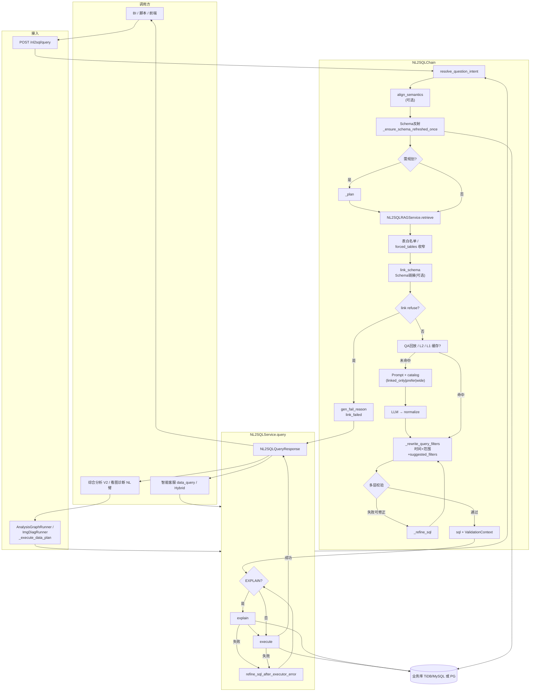
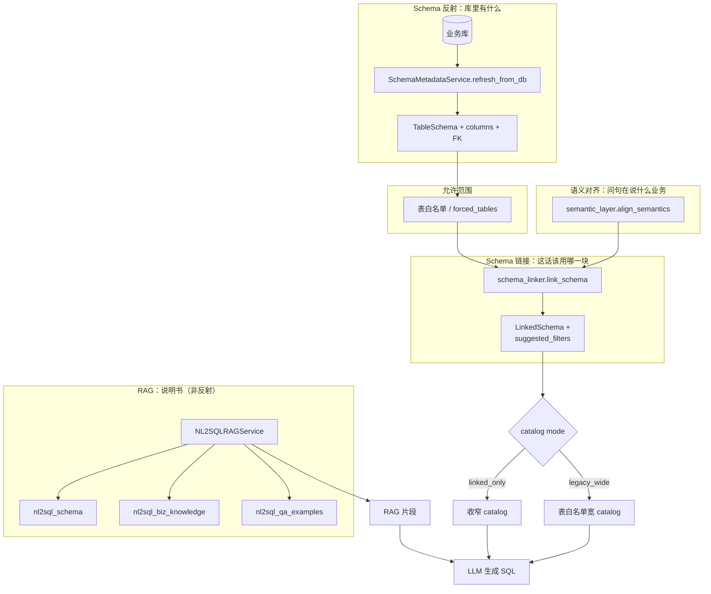
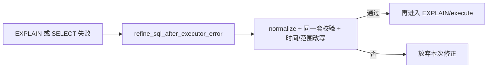

# 企业级 NL2SQL 基座实现方案

> **版本**：2026-10-20（在 2026-09-11 P6 基础上，增补 **§9 优化增强方向**；流程中 **显式拆分 Schema 反射 vs Schema 链接**；并对照现网补齐调用方编排说明）  
> 本文档描述本仓库 **当前已实现** 的 NL2SQL 基座：与 **RAG** 并列的 **AI 应用基础能力**；接入形态包括 **独立 HTTP**、**智能客服内嵌**、**综合分析 V2（`run-with-nl2sql` / `run-with-nl2sql-stream`）**、**综合分析看图诊断（`run-img-diag` / `run-img-diag-stream`，NL2SQL 并行臂）** 与 **数据查询智能体** 等，底层均复用同一 `NL2SQLService`。  
> **域差异原则**：不设运行时双管线分流；锅炉四管 / 地面沉降共用「意图 →（可选）语义对齐 → **Schema 反射（连库读真实表列）** → 白名单/forced_tables → RAG →（可选）**Schema 链接（问句↔表列）** → 缓存 → Prompt → LLM → 时间·范围·suggested_filters 改写 → 校验 → 执行」；差异仅在 `NL2SQL_BUSINESS_DOMAIN` + `configs/nl2sql_business/<domain>/` 配置包。调用方编排（锁表 / period 短路 / HITL）在基座外，见 §4.1、§9。  
> **易混概念**：**Schema 反射** = 程序连接业务库，反射「库里有什么表/列」；**Schema 链接** = 把问句业务绑定对到这些表/列（不是 LLM 连库摸结构）。  
> 地降改造总方案（设计与验收）：`docs/基于地降所项目改造/NL2SQL基座改造.md`。  
> **分层标口径专项（P6）**：`docs/基于地降所项目改造/NL2SQL基座改造补充-分层标数据汇总逻辑(三维口径与层位字典)实现方案.md`（周期初−末 / 正下沉；层位0与压缩层边界标注入）。  
> 实现细节与文件映射见 `framework-guide/NL2SQL整体实现技术说明.md`；代码行为明细见 `enterprise-level_transformation_docs/NL2SQL当前完整实现逻辑说明-代码对照版.md`；问句时间/范围详设见 `docs/NL2SQL自然语言时间和范围窗口解析&改写改造落地方案.md`。  
> **流程图体例**对齐 `enterprise-level_transformation_docs/企业级智能客服 LangGraph 框架实现方案.md` §4.0：先 **业务视角（文字流程）**，再 **实现视角（代码级流程图）**（框内优先 `file:` / 类·函数 + `说明:`）。

> 当前 NL2SQL 已实现 L2/L1 生成阶段缓存、校验通过后可选写入 **`nl2sql_qa_examples`**（**五元组**去重，含 **`plan_template_version`**）；运维 **`GET`/`PATCH /rag/nl2sql-auto-qa`** 支持按类型/q*/plan 版本筛选。缓存 `policy_fp` 含 domain、表白名单指纹、catalog mode、**semantic_version**，避免跨业务/跨语义版本脏命中。

---

## 0. 前提重要说明

> 效果较好的 NL2SQL 前提：知识库摄入较完善（表结构、字段、表间关系认知 = **RAG 知识库 + 数据库反射**；地降开启语义链接后，**语义资产 + LinkedSchema** 进一步收窄表列）。

1. 部署级选定业务域：`NL2SQL_BUSINESS_DOMAIN=boiler_four_tube | subsidence` → 加载 `configs/nl2sql_business/<domain>/profile.yaml`（表白名单、JOIN、方言、词表、实体规则、Prompt 版本、语义开关等）。  
2. 业务库连接：host/port/库名/用户默认来自 profile `db.*`；**密码仅** `DB_PASSWORD` / `DB_URL`（勿把明文密码写入 git）。显式 `DB_*` / `NL2SQL_*` 仍优先于 profile。  
3. RAG 摄入须覆盖命名空间：`nl2sql_schema`、`nl2sql_biz_knowledge`、`nl2sql_qa_examples`（同 namespace，靠摄入内容区分业务；地降源文件见 `configs/nl2sql_business/subsidence/rag/`）。  
4. 换业务域时：同步 **配置包 + 业务库 + RAG 内容 + Prompt 版本**（编排代码复用）；地降 PG 须镜像内已装 **asyncpg**（有网机构建）。

**效果优化方向（摘要）**：

```text
启用 nl2sql_qa_examples（强烈建议）——「问法 → 标准 SQL」样例通常比堆表结构更提准确率。
启用 nl2sql_biz_knowledge（建议）——术语、统计口径、时间字段叙述；地降另摄入层位0摘要。
地降：语义资产 + Schema 链接（NL2SQL_SEMANTIC_LINK_ENABLED，profile 默认开启）——主表/度量列选对率主杠杆。
地降 P6：fcb_layer_map → 站点沉降注入层位0标；压缩层/层间注入相邻层位边界标（见 P6 专项）。
库内补外键（若允许）——catalog 出现 FK: 提示；地降另有 join_whitelist（project_name=t_station.name）。
图检索（若已部署 GraphRAG）——补充实体关系召回（与 FK、文档组合）。
```

**地降周期沉降口径（P6，与季报脚本一致）**：`Δ = total_settle(窗初) − total_settle(窗末)`（初−末）；**Δ>0 下沉倾向，Δ<0 回弹**。站点沉降用监测层位=0 代表标；压缩层 `compress(i→i+1)=Δ(i)−Δ(i+1)`。细则见 P6 专项，勿再写「终−初 / 负值下沉」。

---

## 1. 文档目的与范围

| 项 | 说明 |
|----|------|
| **目的** | 为企业集成、运维排障、二次开发提供 **统一叙述 + 可对照代码的双视角流程图**（含多业务域配置包与语义链接）。 |
| **范围** | `app/nl2sql/*`、`app/services/nl2sql_service.py`、`app/api/nl2sql.py`；`configs/nl2sql_business/**`；客服 `data_query`；综合分析 `run-with-nl2sql*` / `run-img-diag*` / 地降五类 `subsidence_*`；相关配置与日志。 |
| **不在范围** | 业务库建模规范、黄金集可执行率联调报告细节；一期不做基座内多轮澄清 / 查询类型五阶段 / 图表引擎。演进设计见 `docs/基于地降所项目改造/NL2SQL基座改造.md`。 |

---

## 2. 基座定位：与 RAG 并列的基础能力

- **共性**：共用向量检索基座、`scene="nl2sql"` 检索策略、大模型 endpoint、`PromptTemplateRegistry`、日志与 Prometheus 指标。  
- **差异**：  
  - **RAG**：非结构化知识 → 片段 → 自然语言回答。  
  - **NL2SQL**：自然语言 → **受控只读 SQL** → **结构化 `rows`**，强依赖 **DB 反射**、**SQL 安全校验**；地降部署可叠加 **语义对齐 + 显式 Schema 链接** 收窄 catalog。  
- **多业务域（一套进程一个 domain）**：

  | domain | 方言 | 语义链接（默认） | Prompt | 典型表白名单 |
  |--------|------|------------------|--------|--------------|
  | `boiler_four_tube` | TiDB/MySQL | 关（`legacy_wide`） | `v2` | 锅炉台账/监测表集 |
  | `subsidence` | PostgreSQL | 开（`linked_only`） | `v2_subsidence` | 8 表 `t_data_wash_*` + `t_station` |

- **接入形态**（均复用 `NL2SQLService.query`）：  

  | # | 形态 | 入口 | 要点 |
  |---|------|------|------|
  | 1 | 直连问数 | `POST /nl2sql/query` | 返回 `sql` + `rows`（可选 `parsed_intent`、`gen_fail_reason`） |
  | 2 | 智能客服 | 图节点 `nl2sql_answer` | `record_conversation=False`；可读顶层 `gen_fail_reason`（如 `link_failed:…`） |
  | 3 | 综合分析 V2 | `POST /analysis/run-with-nl2sql*` | `acquire_data` 按 plan **多次** `query`；地降五类 `subsidence_*` |
  | 4 | 看图诊断 | `POST /analysis/run-img-diag*` | NL 并行臂同源；可传 `confirmed_scope`（HITL） |
  | 5 | **数据查询智能体** | `POST /data-query-agent/run-stream` | 库锁定后传可选 **`forced_tables`**（一张 `t_data_wash_*`）；**省略该字段 = 现网全量白名单行为** |

---

## 2.1 配置包驱动（部署级）

```text
显式环境变量 NL2SQL_* / DB_* / ANALYSIS_NL2SQL_*
    ＞  profile.yaml（由 NL2SQL_BUSINESS_DOMAIN 选定）
    ＞ 代码默认值
```

配置包目录（摘要）：

```text
configs/nl2sql_business/
  boiler_four_tube/   # profile、table_scope、join_whitelist、语义占位（默认关）、配置项说明.md
  subsidence/         # profile、8 表白名单、JOIN、scope_lexicon、entity_rules、
                      # semantic/*（含 dimensions/fcb_layer_map.yaml）、rag/*、配置项说明.md
                      # （黄金集在 tests/fixtures/nl2sql_subsidence_golden_set.json，不进配置包）
```

`profile.yaml` 典型字段：`db.*`（无密码）、`nl2sql.semantic_link_enabled`、`sql_dialect`、`prompt_default_version`、`schema_link_catalog_mode`、`on_link_failure`、`inject_parsed_intent`、词表/实体规则路径、表白名单文件等。地降另有 **`nl2sql.fcb_layer_map_file`**（层位字典权威路径）与 **`rag.biz_source_files`**（含 `nl2sql_biz_knowledge.md` + `nl2sql_biz_knowledge_fcb_layer0_stations.md`）。运维极简见企业级简版 §4.4 与 `app/app-deploy/.env.example` NL2SQL 段。

### 2.2 地降语义对齐扩展（P6 层位注入）

当 `NL2SQL_BUSINESS_DOMAIN=subsidence` 且 `semantic_link_enabled=true` 时，`align_semantics` 在指标/监测类型/行政区之外：

| 问句 grain | 注入内容 | `parsed_intent.semantic` |
|------------|----------|---------------------------|
| **B. 站点/地面沉降** | 该站（或行政区/全市范围）**监测层位=0** 的 `station_name` | `preferred_station_names`；告警如 `fcb_layer0_*` |
| **C. 压缩层/层间** | 相邻层位 `i` 与 `i+1` 边界标；「第 N 压缩层」→ `(N-1→N)` | `compress_pairs` + 边界标进 `preferred_station_names`；`source=fcb_compress` |
| **A. 显式标编号** | 问句中的 `F8-7` 等保留，不强制改成层位0 | `fcb_explicit_mark` |

随后 `link_schema` 可将上述标写入 `suggested_filters`（`station_name` IN/等值）；`inject_parsed_intent=true` 时 Prompt「已识别问句意图」块展示优选标 / 压缩层对。权威字典：`configs/nl2sql_business/subsidence/semantic/dimensions/fcb_layer_map.yaml`。

---

## 3. 核心模块一览

| 模块 | 路径 | 职责摘要 |
|------|------|-----------|
| HTTP 直连 | `app/api/nl2sql.py` | 鉴权后转发 `NL2SQLService` |
| HTTP 分析 | `app/api/analysis.py` | `run-with-nl2sql*` / `run-img-diag*` |
| 分析编排 | `analysis_graph_runner.py`、`analysis_img_diag_runner.py` | `_execute_data_plan`；地降 `subsidence_*` plan/synthesis |
| 客服查数成文 | `chatbot_nl2sql_answer.py` | `run_chatbot_nl2sql_query`；消费 `gen_fail_reason` |
| 服务层 | `app/services/nl2sql_service.py` | Chain + Executor + EXPLAIN/执行 refine；填充 `gen_fail_reason` |
| 业务配置包 | `nl2sql_business_profile.py` + `intent_config.py` | domain → profile；与 `app/core/config.py` 合并 DB/NL2SQL 默认 |
| 生成链路 | `app/nl2sql/chain.py` | 意图 → **语义对齐** → **Schema 反射** → 白名单/RAG → **Schema 链接** → 缓存 → Prompt → LLM → **时间·范围改写（含 PG 适配）** → 校验/refine |
| 语义层 | `semantic_layer.py` | 加载 `semantic/*`（含 **`fcb_layer_map`**）；`align_semantics` → `parsed_intent.semantic`（指标 + **层位0 / 压缩层边界标**） |
| Schema 反射 | `schema_service.py` | **连库**反射真实表/列（`refresh_from_db`）；PG/MySQL；地降可含沉降 schema + `om_result`；**不是** Schema 链接 |
| Schema 链接 | `schema_linker.py` | `link_schema`：问句绑定 → 主表/列/JOIN/`suggested_filters`；再按 catalog mode 收窄；`refuse`/`best_effort` |
| SQL 方言 | `sql_dialect.py` | MySQL 时间表达式 → PostgreSQL（`adapt_time_window`） |
| 问句意图 | `question_intent.py`、`time_intent_display.py`、`scope_parser_rule.py`、`scope_parser_llm.py`、`scope_parser_subsidence.py` | 时间 **始终规则**（输出后按方言适配）；范围默认 **rule**；subsidence 走地降解析器；`confirmed_scope` → `human_confirmed` |
| 意图展示 | `question_intent_display.py` | Prompt 注入时间/范围 + **语义指标 / 优选标 / 压缩层对 / 链接主表与建议过滤** |
| 专用 RAG | `rag_service.py` | 三命名空间检索 |
| 缓存 / QA | `sql_cache.py`、`sql_skeleton.py`、`qa_feedback.py` | L2/L1；`policy_fp` 含 domain / semantic_version |
| Prompt | `prompt_builder.py` + `configs/prompts.yaml` | `nl2sql`（`v2` / `v2_subsidence`）；`analysis_*_subsidence_*` |
| 校验/执行 | `validator.py`、`executor.py` | 只读、白名单；PG 建连不加 MySQL `charset` |
| 实体规则 | `entity_rules.py` | 可选否定规则（可从 profile `entity_rules_file` 加载） |
| 范围改写 | `scope_sql_rewrite.py` | 锅炉 `@device_keyword` 等；地降 `@district` / `@station_*` |

---

## 4. 业务逻辑流程图

> 体例同智能客服方案 §4.0：**业务视角**不出现文件名，便于产品/运维对齐；**实现视角**每个框标 `file:` / 类·函数 + `说明:`，与当前仓库调用链一致。

### 4.0 端到端主路径（`POST /nl2sql/query` 与所有内嵌复用的同一基座闭环）

#### 业务视角（文字流程）

从**业务与使用方**看，一次「自然语言 → 查库结果」主线如下（客服/综合分析只是**多次或包装后**调用同一闭环）。

```text
                    【调用方发起自然语言问数】
                                  │
                                  ▼
              ┌───────────────────────────────────┐
              │ 接入：用户、会话、自然语言问题；     │
              │ 部署已选定业务域（锅炉 / 地降等）   │
              │ 可选：分析场景、计划子任务、时间意图 │
              │ 文本、人工确认范围（看图诊断 HITL） │
              └───────────────────┬───────────────┘
                                  ▼
              ┌───────────────────────────────────┐
              │ 问句意图解析（基座内、先于生成 SQL） │
              │ · 时间：程序规则（近一周/昨天/季度…）│
              │ · 范围：锅炉＝机组/设备/管排等；     │
              │   地降＝行政区/测站等；可选 LLM；    │
              │   若已人工确认则直接采用范围        │
              └───────────────────┬───────────────┘
                                  ▼
              ┌───────────────────────────────────┐
              │（可选，地降默认开）语义对齐         │
              │ 问句 → 业务指标/实体绑定            │
              │ （语义建模资产，不连库摸表结构）    │
              └───────────────────┬───────────────┘
                                  ▼
              ┌───────────────────────────────────┐
              │ Schema 反射（程序连业务库）         │
              │ 读出库中真实有哪些表、哪些列         │
              │ （≠ Schema 链接；≠ LLM 连库）       │
              └───────────────────┬───────────────┘
                                  ▼
              ┌───────────────────────────────────┐
              │ 表白名单收窄（± 调用方锁表）         │
              │ + Schema/业务/样例三类 RAG 补说明   │
              │ → 得到「允许看见的表列目录」         │
              └───────────────────┬───────────────┘
                                  ▼
              ┌───────────────────────────────────┐
              │（可选，地降默认开）Schema 链接      │
              │ 业务绑定 → 主表/列/建议过滤；        │
              │ 再按链接结果收窄 catalog；          │
              │ 链接失败：拒绝生成 或 宽 catalog 降级│
              └───────────────────┬───────────────┘
                                  ▼
              ┌───────────────────────────────────┐
              │（可选）命中生成缓存或 QA 样例回放 → │
              │ 仍须过校验与时间/范围改写           │
              │ 未命中 → 拼装 Prompt → 大模型出 SQL │
              └───────────────────┬───────────────┘
                                  ▼
              ┌───────────────────────────────────┐
              │ 程序改写：时间窗占位符（按方言适配   │
              │ MySQL↔PostgreSQL）、范围占位符、    │
              │ suggested_filters 强制写入 →        │
              │ 安全校验（失败可让模型按错误再验）  │
              └───────────────────┬───────────────┘
                                  ▼
              ┌───────────────────────────────────┐
              │ 执行：可选先 EXPLAIN，再只读 SELECT；│
              │ 执行失败可再修正（有次数上限）      │
              └───────────────────┬───────────────┘
                                  ▼
              ┌───────────────────────────────────┐
              │【结束】返回 SQL + 结果行；          │
              │ 可选 parsed_intent（含 semantic /   │
              │ linked_schema）；失败可读           │
              │ gen_fail_reason（如 link_failed）   │
              └───────────────────────────────────┘
```

补充说明（业务口径）：

- **时间**始终由基座规则解析；可用 `time_intent_text` 指定抽文本；**不能**靠 `confirmed_scope` 覆盖时间窗。地降执行前会把时间表达式适配为 **PostgreSQL**。  
- **范围**：默认规则；可开 LLM；看图诊断等可传 **`confirmed_scope`** → `human_confirmed`。地降范围词表/解析器与锅炉不同（行政区、测站等）。  
- **Schema 反射**：程序连接业务库，反射真实表/列（「库里有什么」）；与是否开启语义链接无关，生成前通常都会走。  
- **Schema 链接**（常与「语义链接」开关一并启用）：把问句业务绑定对到反射+白名单后的表/列（「这话该用哪一块」）；失败策略见 `on_link_failure`（`refuse` / `best_effort`）。地降语义对齐另含 **P6 层位字典注入**（站点→层位0；压缩层→相邻边界标）。  
- **呈现**：基座返回 `sql`/`rows`（及可选意图/失败原因）；客服收紧分析、综合分析报告合成均在**调用方**完成。

---

#### 实现视角（代码级流程图）

对齐 **当前仓库** 基座闭环。框内优先 **Python 路径**、**类 / 函数**，并附 **`说明:`**。客服 / 综合分析在入口处分岔后，均进入同一 `NL2SQLService.query`。

```text
         【入口 A】POST /nl2sql/query
         【入口 B】客服 nl2sql_answer / Hybrid 查数臂
         【入口 C】分析 acquire_data → 多次 query
         【入口 D】看图诊断 NL 臂（可带 confirmed_scope）
                                  │
                                  ▼
┌─────────────────────────────────────────────────────────────────┐
│ 【HTTP 直连入口】（仅入口 A）                                   │
│ file: app/api/nl2sql.py                                         │
│ fn:   nl2sql_query                                              │
│ 说明: 鉴权后转发；502 封装执行错误                               │
└───────────────────────────────┬─────────────────────────────────┘
                                  ▼
┌─────────────────────────────────────────────────────────────────┐
│ 【服务编排】                                                    │
│ file:  app/services/nl2sql_service.py                           │
│ class: NL2SQLService                                            │
│ meth:  query                                                    │
│ 说明: 可选写会话 → Chain 生成 → EXPLAIN?/execute → 执行失败 refine│
│       填充 gen_fail_reason；指标 NL2SQL_QUERY_COUNT / ERROR；    │
│       可选返回 parsed_intent（含 semantic / linked_schema）     │
│ req:  app/models/nl2sql.py · NL2SQLQueryRequest                 │
│       （question / time_intent_text / confirmed_scope / …）     │
└───────────────────────────────┬─────────────────────────────────┘
                                  ▼
┌─────────────────────────────────────────────────────────────────┐
│ 【Chain：意图 → 语义对齐 → Schema 反射】                        │
│ file:  app/nl2sql/chain.py · NL2SQLChain                        │
│ meth:  generate_sql_with_validation_context                     │
│ ① resolve_question_intent — 时间规则 + 范围 rule/LLM/HITL       │
│    └─ question_intent.py；地降另走 scope_parser_subsidence      │
│       · confirmed_scope → parse_mode=human_confirmed（仅范围）  │
│ ② align_semantics（semantic_link 开启时）                       │
│    └─ semantic_layer.py → parsed_intent.semantic                │
│       · 地降：metrics + 默认 fcb；P6 注入层位0 / 压缩层边界标  │
│ ③ Schema 反射（程序连库，读真实表列）                           │
│    └─ _ensure_schema_refreshed_once → schema_service.py         │
│       · SchemaMetadataService.refresh_from_db（PG/MySQL）       │
│       · 地降：当前沉降 schema +（若配置）om_result 运维表       │
│       · 说明: 「库里有什么」；≠ Schema 链接；≠ LLM 连库        │
└───────────────────────────────┬─────────────────────────────────┘
                                  ▼
┌─────────────────────────────────────────────────────────────────┐
│ 【Chain：规划 → RAG → 白名单/锁表 → Schema 链接】               │
│ ④ _plan（可选；真实库反射成功时默认跳过，防虚构表名）           │
│ ⑤ NL2SQLRAGService.retrieve — schema/biz/qa 三命名空间          │
│    └─ rag_service.py；地降 biz 含口径 + 层位0 摘要 md           │
│ ⑥ _resolve_table_scope — 表白名单 ∩ 意图收窄 ∩ forced_tables   │
│ ⑦ link_schema（semantic_link 开启时；依赖③反射后的 table_columns）│
│    └─ schema_linker.py → linked_schema；catalog 模式收窄        │
│       · suggested_filters：project_name / station_name（层位） │
│       · refuse → 提前结束（gen_fail_reason=link_failed:…）      │
│       · 说明: 「这话该用哪张表/哪些列」；≠ 反射                 │
│ ⑧ 可选 QA 槽位严格回放（qa_feedback）                           │
│ ⑨ 可选 L2 / L1（policy_fp 含 domain、semantic_version、…）     │
│ 说明: 反射在链接之前；缓存命中后仍走改写+校验                   │
└───────────────────────────────┬─────────────────────────────────┘
                                  ▼
┌─────────────────────────────────────────────────────────────────┐
│ 【Chain：生成 → 改写 → 校验】（缓存未命中或需重生）             │
│ ⑩ PromptBuilder + scene=nl2sql（v2 / v2_subsidence）            │
│    catalog 来自 linked_only / linked_prefer / legacy_wide       │
│    可注入 semantic / linked_schema 摘要（INJECT_PARSED_INTENT） │
│    · 地降意图块可含优选标 / 压缩层对 / 建议 station_name 过滤  │
│ ⑪ LLM → normalize_sql                                           │
│ ⑫ _rewrite_* + _rewrite_query_filters                           │
│    · 时间占位符 + sql_dialect.adapt_time_window（PG）           │
│    · 范围：锅炉 @unit/@device…；地降 @district / @station_*     │
│    · suggested_filters 强制写入（覆盖/层位/区县/运维 type 等） │
│ ⑬ SQLValidator + 白名单 + 列–表绑定 + entity_rules；可 refine   │
│ 返回 (sql, NL2SQLValidationContext)                             │
└───────────────────────────────┬─────────────────────────────────┘
                                  ▼
┌─────────────────────────────────────────────────────────────────┐
│ 【服务层执行闭环】NL2SQLService.query 续                        │
│ file: app/nl2sql/executor.py · SQLExecutor                      │
│  · NL2SQL_EXPLAIN_BEFORE_EXECUTE → explain                      │
│  · execute(SELECT)（PG 经 asyncpg / SQLAlchemy）                │
│  · 失败且可 refine → chain.refine_sql_after_executor_error      │
│    （次数 ≤ NL2SQL_MAX_EXEC_REFINES）                           │
└───────────────────────────────┬─────────────────────────────────┘
                                  ▼
┌─────────────────────────────────────────────────────────────────┐
│ 【响应】NL2SQLQueryResponse(sql, rows[, parsed_intent,          │
│         gen_fail_reason])                                       │
│ 直连回客户端；客服可读 gen_fail_reason；分析消费 rows 合成报告  │
└─────────────────────────────────────────────────────────────────┘
```

**图注（调用约定）**：

- 框内优先 **`file:` + 类/方法**，其后 **`说明:`** 为职责摘要。  
- **所有接入形态**在 `NL2SQLService.query` 汇合；差异在请求字段与是否 `record_conversation`；**业务差异靠部署 domain 配置包**，不靠请求内切换。  
- **`confirmed_scope` 只覆盖范围**；时间仍规则解析，再按方言适配。

**实现落点速查（文件 → 职责）**

| 环节 | 文件 | 符号（简练） |
|------|------|----------------|
| HTTP 直连 | `app/api/nl2sql.py` | `nl2sql_query` |
| 请求/响应模型 | `app/models/nl2sql.py` | `NL2SQLQueryRequest` / `Response`（含 `gen_fail_reason`） |
| 业务配置包 | `nl2sql_business_profile.py`、`intent_config.py` | domain → profile 合并 |
| 服务 | `app/services/nl2sql_service.py` | `query` |
| Chain | `app/nl2sql/chain.py` | `generate_sql_with_validation_context`、改写、refine |
| 语义对齐 | `semantic_layer.py` | `align_semantics` |
| Schema 反射 | `schema_service.py` | `refresh_from_db` / `_ensure_schema_refreshed_once`（库里有什么） |
| Schema 链接 | `schema_linker.py` | `link_schema`（问句↔表列 + suggested_filters） |
| 方言 | `sql_dialect.py` | `adapt_time_window` |
| 意图门面 | `question_intent.py` | `resolve_question_intent` |
| 时间规则 | `time_intent_display.py` | `extract_time_window_*`、锚点 lookback |
| 范围规则/LLM/地降 | `scope_parser_rule.py`、`scope_parser_llm.py`、`scope_parser_subsidence.py` | |
| 范围改写 | `scope_sql_rewrite.py` | 锅炉 + 地降占位符 |
| RAG | `rag_service.py` | `retrieve`（说明书，非反射） |
| 缓存 / QA | `sql_cache.py`、`sql_skeleton.py`、`qa_feedback.py` | L2/L1；`policy_fp` |
| 校验 / 执行 | `validator.py`、`executor.py` | `validate`、`explain`、`execute` |
| 客服包装 | `chatbot_nl2sql_answer.py` | `run_chatbot_nl2sql_query` |
| 分析取数 | `analysis_graph_runner.py` 等 | `_execute_data_plan`；`subsidence_*` |

---

### 4.1 智能客服内嵌（`data_query` / Hybrid 查数臂）

#### 业务视角

```text
  意图判为「结构化查库」或 Hybrid 需要查数
            │
            ▼
  调用同一 NL2SQL 基座得到 sql + rows
            │
            ▼
  列过滤展示 →（可选）收紧分析成自然语言
            │
            ▼
  流式/结束帧带回 used_nl2sql、nl2sql_analysis 等 meta
```

#### 实现视角

```text
┌─────────────────────────────────────────────────────────────────┐
│ file: chatbot_graph_runner.py · _node_nl2sql_answer             │
│ 说明: data_query 分支；Hybrid 臂内亦可调同一查数入口            │
└───────────────────────────────┬─────────────────────────────────┘
                                  ▼
┌─────────────────────────────────────────────────────────────────┐
│ file: chatbot_nl2sql_answer.py · run_chatbot_nl2sql_query       │
│ 前置: chatbot_settle_prepare.prepare_chatbot_settle_query       │
│       · 运维问句：不锁沉降表（走 om 意图收窄）                  │
│       · 沉降：forced_tables + 规则 scope（非查询台 HITL）       │
│       · 站点+区间时间：period_sql 优先；失败回退 LLM            │
│ 说明: 构造 NL2SQLQueryRequest（可带 sql_gen_extra_hint /        │
│       forced_tables / confirmed_scope / structured_filters）    │
│       → NL2SQLService.query(record_conversation=False)          │
│       → 可读 gen_fail_reason（如 link_failed）决定是否提示重试  │
│       → summarize_nl2sql_with_llm / analysis_stream_plan        │
│ meta: nl2sql_library_source / period_deterministic / ops_routed │
│ 展示列过滤: chatbot_nl2sql_display.filter_chatbot_nl2sql_…    │
└─────────────────────────────────────────────────────────────────┘
```

数据查询智能体（`data-query-agent`）在进基座前另有：库锁定 `forced_tables`、`confirmed_scope`、模板问句；站点+区间时间走 `period_sql`，**失败回退 LLM**（`acquire._query_one`）。运维问句在查询台拒答并引导客服（与问答「运维走客服 NL2SQL」分工）。

详述见 **`企业级智能客服 LangGraph 框架实现方案.md`** §4.6 / §4.7。

---

### 4.2 综合分析 V2（`POST /analysis/run-with-nl2sql*`）

#### 业务视角

```text
  用户提交分析类型 + 自然语言 query
  （锅炉超温等 / 地降五类 subsidence_*）
            │
            ▼
  规划前检索与数据计划（多子任务问句）
            │
            ▼
  按依赖分层取数：同层可并行多次「问句→SQL→结果」
  （每次 = 基座闭环；时间意图优先用用户原句，防 plan 附录污染）
            │
            ▼
  质量门 → 业务 RAG → 合成结构化报告（非客服口语化链路）
```

#### 实现视角

```text
┌─────────────────────────────────────────────────────────────────┐
│ file: app/api/analysis.py · run_analysis_nl2sql(_stream)        │
│ → AnalysisService → AnalysisGraphRunner.run_with_nl2sql         │
│ 地降: analysis_plan/synthesis 走 analysis_*_subsidence_* Prompt │
└───────────────────────────────┬─────────────────────────────────┘
                                  ▼
┌─────────────────────────────────────────────────────────────────┐
│ acquire_data → _execute_data_plan                               │
│ 说明: dependency 分层；默认同层 asyncio.gather 并行 query       │
│ 每项: NL2SQLQueryRequest(question=task.question,                │
│       time_intent_text=用户 query, plan_item_id, …)             │
│       record_conversation=False；单任务最多 2 次尝试            │
│ 开关: ANALYSIS_NL2SQL_ACQUIRE_* / max_nl2sql_calls              │
└─────────────────────────────────────────────────────────────────┘
```

---

### 4.3 综合分析看图诊断（`POST /analysis/run-img-diag*`）

#### 业务视角

```text
  上传图像 + 泄漏位置/问句等
            │
            ├──────────────┬──────────────────┐
            ▼              ▼                  ▼
       视觉识别臂     NL2SQL 取数臂      业务 RAG 臂
            │              │                  │
            │     （可先 HITL 确认范围）       │
            │              │                  │
            └──────────────┴──────────────────┘
                            ▼
                   汇合后合成报告（同步或流式）
```

#### 实现视角

```text
┌─────────────────────────────────────────────────────────────────┐
│ AnalysisImgDiagGraphRunner：并行 lane                           │
│ NL 臂：plan_context_rag(scene=nl2sql) → acquire_data            │
│        → _execute_data_plan（与 §4.2 同源）→ data_quality_gate  │
│ HITL: confirmed_scope / scope_intent_text / original_query      │
│       注入 NL2SQLQueryRequest → 基座 human_confirmed（仅范围）  │
└─────────────────────────────────────────────────────────────────┘
```

---

### 4.4 问句意图与 SQL 改写（基座内关键子链）

#### 业务视角

```text
  用户问句（或更干净的 time_intent / 确认范围）
            │
            ├─ 时间：近 N 天 / 昨天 / 本月 / 季度… → 生效时间窗
            │        （无表达时默认「昨天」口径；地降再适配 PG）
            ├─ 范围：锅炉＝机组/设备/管排…；地降＝行政区/测站…
            │        （HITL 确认则跳过自动范围解析）
            ▼
  模型 SQL 中的 @t_*、范围占位符被程序替换
            ▼
  再执行校验与查库
```

#### 实现视角

```text
resolve_question_intent
  ├─ confirmed_scope? → QuestionScopeIntent 直接采用；时间仍 extract_* 规则
  └─ else → 按 domain：锅炉 scope_parser_rule/llm；地降 scope_parser_subsidence
            + extract_time_window / extract_time_anchor
            │
            ▼
_rewrite_query_filters（chain.py）
  ├─ _resolve_time_window_for_rewrite（锚点向前 N 天 / plan 长窗仲裁）
  ├─ _rewrite_time_placeholders / 字面量窗 → sql_dialect.adapt_time_window
  └─ rewrite_scope_sql_placeholders（@unit/@device… 或 @district/@station_*）
```

| 能力 | 是否基座 | 覆盖方式 |
|------|----------|----------|
| 时间解析 | 是（规则） | `time_intent_text`；**无** confirmed 时间窗 API；方言适配在改写阶段 |
| 范围解析 | 是（默认 rule） | domain 词表/解析器；或 `confirmed_scope` |
| 锅炉字段 | 规则可覆盖 LLM | `finalize_llm_scope`（锅炉域） |

---

## 5. 代码版补充图（Mermaid）

> 与 §4 实现视角语义一致，便于编辑器预览；排障优先对照 §4.0 代码框。

### 5.1 端到端（服务 + Chain + 执行）



### 5.2 Schema 反射、语义对齐、Schema 链接与 RAG



### 5.3 执行期 refine



---

## 6. 关键工程要点

| 主题 | 说明 |
|------|------|
| **业务域** | `NL2SQL_BUSINESS_DOMAIN` → `configs/nl2sql_business/<domain>/`；一套进程一个 domain。 |
| **连接串** | 密码用 `DB_PASSWORD`/`DB_URL`；host/port/库/用户优先显式 `DB_*`，否则 profile `db.*`。PG 需 **asyncpg**。 |
| **表白名单 / JOIN** | 默认跟配置包文件；显式 `ANALYSIS_NL2SQL_TABLE_SCOPE_*` 仍可覆盖。地降另有 `join_whitelist`。 |
| **Schema 反射** | `schema_service.refresh_from_db`（经 Chain `_ensure_schema_refreshed_once`）；程序连库读真实表/列；与语义开关无关。 |
| **语义对齐 + Schema 链接** | `NL2SQL_SEMANTIC_LINK_ENABLED` + `SCHEMA_LINK_CATALOG_MODE` + `ON_LINK_FAILURE`；地降默认开；对齐在反射前，链接在反射+白名单之后；P6 层位注入随语义资产加载。 |
| **外键与 JOIN** | 反射 FK 写入 catalog；无物理 FK 依赖 RAG / join 白名单。 |
| **列–表绑定** | `schema_ok` 时校验 `alias.column` 是否属于该物理表。 |
| **实体规则** | 否定规则；路径可来自 profile `entity_rules_file`。 |
| **意图防污染** | 综合分析传 `time_intent_text=用户原句`，避免 plan 附录污染。 |
| **HITL 范围** | `confirmed_scope` → `human_confirmed`；**不覆盖时间**。 |
| **缓存** | `policy_fp` 含 domain、allowlist、catalog mode、**semantic_version**。 |
| **方言** | 时间改写经 `sql_dialect`；勿在 Prompt 写死仅 MySQL 函数（地降用 `v2_subsidence`）。 |
| **EXPLAIN / 执行 refine** | 见环境变量表；无 LangChain 时 refine 不生效。 |
| **会话隔离** | 直连与客服建议不同 `session_id` 前缀。 |

---

## 7. 配置与环境变量（摘要）

| 变量 | 作用（与代码默认一致） |
|------|------|
| `NL2SQL_BUSINESS_DOMAIN` | `boiler_four_tube` \| `subsidence` → 加载配置包 |
| `DB_URL` / `DB_PASSWORD` / `DB_*` | 业务库；密码勿写入 profile |
| `NL2SQL_SEMANTIC_LINK_ENABLED` | 语义对齐 + Schema 链接总开关（可被 profile 默认） |
| `NL2SQL_SCHEMA_LINK_CATALOG_MODE` | `linked_only` / `linked_prefer` / `legacy_wide` |
| `NL2SQL_ON_LINK_FAILURE` | `refuse` / `best_effort` |
| （profile）`fcb_layer_map_file` | 地降层位字典路径；未设 env 时由 `profile.yaml` 提供 |
| `NL2SQL_SEMANTIC_DICT_PATH` | 语义资产根（覆盖 profile） |
| `NL2SQL_PROMPT_DEFAULT_VERSION` | 如 `v2` / `v2_subsidence` |
| `NL2SQL_DISABLE_PLANNER_WHEN_DB_SCHEMA` | 默认 `true`：反射成功则跳过 `_plan` |
| `NL2SQL_CACHE_ENABLED` | 代码默认 `false`；`.env.example` 示例常开 |
| `NL2SQL_EXPLAIN_BEFORE_EXECUTE` | 默认 `false` |
| `NL2SQL_REFINE_ON_EXEC_ERROR` | 默认 `true` |
| `NL2SQL_MAX_EXEC_REFINES` | 默认 `1` |
| `NL2SQL_ENTITY_RULES` / `_FILE` | 可选否定实体规则 |
| `NL2SQL_INTENT_PARSE_MODE` | 默认 **`rule`**；可选 `llm` / `rule_with_llm_fallback` |
| `NL2SQL_SCOPE_SQL_REWRITE_ENABLED` | 代码默认 **`true`** |
| `NL2SQL_SCOPE_LEXICON_FILE` | 范围词典（可被 profile 指向地降词表） |
| `NL2SQL_SCOPE_PARSE_*` | 范围 LLM 超时/温度/提示词版本 |
| `NL2SQL_INJECT_PARSED_INTENT` / `RESPONSE_INCLUDE_*` / `TRACE_INCLUDE_*` | 意图（含 semantic/link）注入 Prompt / API / trace |
| `NL2SQL_ANCHOR_FALLBACK_*` | plan「锚点向前 N 天」无锚点时的 NOW 回退 |
| `NL2SQL_REJECT_UNRESOLVED_TIME_PLACEHOLDERS` | 拒绝未解析的 `@t_*` |
| `ANALYSIS_NL2SQL_TABLE_SCOPE_*` / `JOIN_WHITELIST*` | 显式覆盖表白名单/JOIN（未设 domain 时的旧路径仍可用） |
| `ANALYSIS_NL2SQL_ACQUIRE_*` | 分析取数同层并行等 |
| `RAG_SCENE_NL2SQL_*` | NL2SQL 检索 profile |

完整列表见 `app/app-deploy/.env.example` 与 `framework-guide/NL2SQL整体实现技术说明.md`（后者待同步基座改造章节）。运维极简：`系统整体逻辑、配置说明-简版.md` §4.4。

**优先级**：显式环境变量 ＞ `profile.yaml`（由 domain 选定）＞ 代码默认。`.env.example` 示例值可能与代码默认不同，以实际部署 `.env` 为准。

---

## 8. 相关文档索引

| 文档 | 内容 |
|------|------|
| `docs/基于地降所项目改造/NL2SQL基座改造.md` | **现网演进主方案**（配置包 / 语义 / Schema 链接 / P6 索引与验收） |
| `docs/基于地降所项目改造/NL2SQL基座改造补充-分层标数据汇总逻辑(三维口径与层位字典)实现方案.md` | **P6 专项**：初−末/正下沉、三维 grain、`fcb_layer_map`、层位0与压缩层注入 |
| `configs/nl2sql_business/subsidence/配置项说明.md` | 地降配置包字段与目录说明 |
| `enterprise-level_transformation_docs/NL2SQL当前完整实现逻辑说明-代码对照版.md` | 代码行为端到端细节（建议同步补 P6 注入句） |
| `framework-guide/NL2SQL整体实现技术说明.md` | 模块映射、API、配置、日志（**待补**配置包与 PG） |
| `docs/NL2SQL系统概要设计.md` | 产品与模块概要（**建议补**多业务域） |
| `docs/NL2SQL缓存实现方案.md` | L2/L1 与 QA；核对 `policy_fp` 含 semantic_version |
| `docs/NL2SQL自然语言时间和范围窗口解析&改写改造落地方案.md` | 时间/范围；地降占位符与方言适配可对照代码 |
| `docs/基于地降所项目改造/NL2SQL基座五阶段改造方案(废弃…)` | **已废弃**；勿作现网依据 |
| `enterprise-level_transformation_docs/系统整体逻辑、配置、运维说明/系统整体逻辑、配置说明-简版.md` | 运维极简（§4.4 已含 domain/`DB_PASSWORD`） |
| `enterprise-level_transformation_docs/项目整体部署运维手册.md` | 部署运维（建议补 domain 与源码挂载） |
| `enterprise-level_transformation_docs/企业级智能客服 LangGraph 框架实现方案.md` | 客服图与 `data_query` |
| `enterprise-level_transformation_docs/企业级综合分析实现和使用说明.md` | `run-with-nl2sql*`；地降 `subsidence_*` 建议补说明 |
| `enterprise-level_transformation_docs/企业级综合分析-看图诊断实现和使用说明.md` | `img_diag` 并行臂与 HITL |

---

## 9. 优化增强方向（2026-10-20）

> 本节对照 §4.0 基座主链路与现网代码梳理结论：主链路与文档 **一致**；差异主要在 **调用方编排**（锁表 / period / HITL）与文档早期对客服「裸问句」的简化叙述（§4.1 已同步）。下列方向按优先级排列，指导后续迭代，不改变「LLM 为填空器、程序为权威」的架构原则。

### 9.1 与 §4.0 主链路一致性结论

| 维度 | 文档 §4.0 / §5 | 现网代码 | 结论 |
|------|----------------|----------|------|
| 基座顺序 | 意图 → 语义对齐 → **Schema 反射** → 白名单/RAG → **Schema 链接** → 缓存 → Prompt → LLM → 改写 → 校验 → 执行 | `chain.py`：`align` → `_ensure_schema_refreshed_once` → RAG/scope → `link_schema` | **一致**（反射已从「认识库表」中拆出单列） |
| Schema 反射 vs 链接 | 反射=连库读表列；链接=问句↔表列 | `schema_service.refresh_from_db` vs `schema_linker.link_schema` | **一致**（文首易混概念已写明） |
| 域差异 | 配置包驱动，无双管线 | `NL2SQL_BUSINESS_DOMAIN` + profile | **一致** |
| 缓存 / QA | L2 / L1 / QA 回放仍过改写+校验 | `sql_cache` / `sql_skeleton` / `qa_feedback` | **一致** |
| 后置改写 | 时间·范围·suggested_filters | 另含 `latest_per_station`、运维 `snapshot_time` | **一致** |
| period / 锁表 | 未写入 §4.0 主框 | 在 **基座外**（查询台 `acquire`、客服 `chatbot_settle_prepare`） | **不矛盾**：属调用方编排，非第二套生 SQL 引擎 |
| 客服入参 | §4.1 原偏「仅 hint」 | 沉降路径已可 `forced_tables` + 规则 scope + period | **已对齐实现；§4.1 已更新** |

**配置权威（与 `configs/nl2sql_business/subsidence/配置项说明.md` 一致）**：区/站首轮解析以 **`scope_lexicon.json`** 为准；`semantic/dimensions/station.yaml` 当前为空占位；库 id↔表以 **`device_type.yaml` + synonyms + 查询台 catalog** 为准；时间由 **`time_intent_display`** 规则解析，不读 dimensions。

### 9.2 架构判断（优化前提）

1. **LLM 是中段生成器**：表/站/覆盖/层位由语义 + 链接 + 改写兜底，不宜改为「更大更自由的 LLM 主路径」。  
2. **正确性重心在后置 rewrite**：尤其 `suggested_filters_rewrite`、时间窗、`latest_per_station`、运维最新批。  
3. **调用方编排决定上限**：`forced_tables` + 结构化 scope ≫ 裸自然语言问句。  
4. **`linked_only` + `on_link_failure=refuse` 双刃剑**：幻觉少，链接错则空 SQL、不进 LLM。

### 9.3 P0 — 进 LLM 之前的约束（性价比最高）

| 方向 | 内容 |
|------|------|
| 编排对齐 | 综合分析 plan 项、裸 `/nl2sql` 在可判定监测类型时传 `forced_tables` / 结构化 scope（复用客服 `chatbot_settle_prepare` 或查询台同类逻辑） |
| 客服 hint 加厚 | 沉降路径 `sql_gen_extra_hint` 补库表 / 周期 Δ / 层位 0 口径（对齐查询台 hint，不只 SELECT 可读性） |
| 链接失败策略 | 已锁表场景：可对锁表内 `best_effort`；无锁表仍 `refuse`，避免乱扫 |
| period 可观测 | 已落地：失败回退 LLM；用 `period_deterministic` / `period_list_fallback_llm` 统计回退率，驱动规则补洞 |

### 9.4 P1 — 提升 LLM 一次成功率

| 方向 | 内容 |
|------|------|
| Prompt 减负 | 大覆盖名单只写「系统注入、勿手写 IN」；避免长 preview 截断误导 |
| 指标→列硬约束 | `metrics.yaml` preferred_columns 在 Prompt 升为「优先/必须」级，减少乱选累计/年沉降列 |
| 「最新」口径 | Prompt 与 `latest_per_station` rewrite 一致，减少日历窗与 DISTINCT ON 打架 |
| 站名权威 | 维持 lexicon 解析；`station.yaml` 空则勿假装语义站维生效；补全或与 lexicon 双写/导出脚本 |
| QA 回放 | 客服/分析在指纹可靠时适度开 strict replay；查询台继续 `disable_qa_slot_replay`（防串库） |

### 9.5 P2 — 链接与语义层

| 方向 | 内容 |
|------|------|
| linker 可观测 | primary_table、filters 条数、refuse 原因进 meta/日志，对照空 SQL |
| device_type 单一真相 | catalog / synonyms / 客服锁库共用，避免第三套别名 |
| RAG 检索查询 | planner 常关时对沉降问句轻量改写（加表名/指标词）提升 schema 召回 |
| 校验前移 | 高频 entity_rules 部分前移为 Prompt 硬禁令 + 链接禁表 |

### 9.6 P3 — 生成后与闭环

| 方向 | 内容 |
|------|------|
| refine 策略 | 白名单错 / 时间占位未解析 / 执行错：有限次、带结构化错误码的 refine |
| 黄金集回归 | `nl2sql_subsidence_golden_set` 分桶：period 命中 / LLM / 运维 / 链接 refuse |
| 缓存指纹 | L1/L2 键纳入 `forced_tables` + scope 哈希，防串结果 |
| 人工校核 schema | `settlement_calibrated` 就绪后的切换与 Prompt / `search_path` 联调 |

### 9.7 明确不优先

- 再堆「更大更自由」的 LLM 生 SQL 主路径（与现架构相反）。  
- 把查询台 HITL / 树选库整包迁入智能问答。  
- 仅补空 `station.yaml` 却不维护 `scope_lexicon.json`（解析权威仍是词表）。  
- 区/市粒度 period 确定性（查询台未做；先把站点+区间做稳）。

### 9.8 建议落地顺序（摘要）

```text
短期：调用方「能锁表则锁、能结构化则结构化、能 period 则 period，失败再 LLM」
中期：Prompt / 链接 / 改写分工更清晰 —— LLM 只管 SELECT 形状与聚合，名单与时间由程序注入
长期：可观测字段 + 黄金集把 refuse / 回退 / refine 变成可量化迭代
```

较合适的下一刀：**分析报告项复用沉降准备逻辑（锁库+scope）**；**沉降路径加厚 `sql_gen_extra_hint`**。

---

*代码变更时请同步更新本文、`NL2SQL基座改造.md`（设计口径）、P6 专项与 `framework-guide/NL2SQL整体实现技术说明.md`（实现映射）。*
