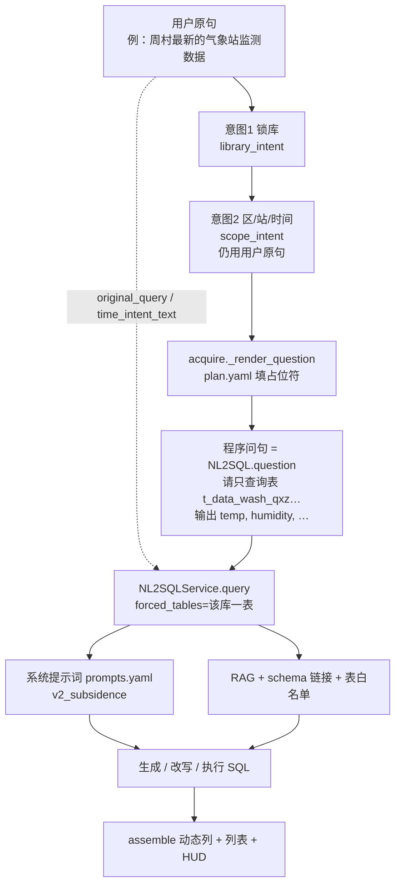

# 数据查询智能体实现和使用说明

> 对照落地说明：`docs/基于地降所项目改造/数据查询智能体实现方案.md`（P0 解析 SQL 闭环、P1 运维与问句增强、P2-2 `GET /hud`、P2-4 前端第三节）。  
> 前端 UI 与接口：`docs/基于地降所项目改造/改造后前端UI及对应接口调用说明/地降所项目前端UI及对应接口调用说明.md` **第三节**。  
> NL2SQL 锁表：`enterprise-level_transformation_docs/企业级NL2SQL基座实现方案.md`（可选 `forced_tables`）。  
> 写法对照：`enterprise-level_transformation_docs/企业级智能客服 LangGraph 框架实现方案.md`。

## 1. 目标与范围

- 目标：地降所「数据查询」页的 **自然语言解析 SQL** 由独立智能体编排，把「树节点库（可空）+ 问句」解析为 **库 / 行政区 / 站点 / 时间** 四元约束，再调用 **NL2SQL 基座** 生成并执行 SQL；一次 JSON 返回库命中 / 选库 HITL / 范围 / 列表+HUD。
- 范围：覆盖 `data_query_agent` 场景的解析主链路（`POST /data-query-agent/run-stream`、`/resume-stream`，一次性 JSON），以及浏览路径（`GET /tree`、`GET /browse` 分页列表、`GET /hud` 补拉）、CSV 导出（`GET /browse/export`、解析成功 `GET /export`）、库注册表（`GET /libraries`）、独立 trace。进程须 `NL2SQL_BUSINESS_DOMAIN=subsidence`。
- 保留：现有 `NL2SQLService.query`、`resolve_question_intent`、统一 `SERVICE_API_KEY` 鉴权不替换；**不传 `forced_tables` 的 `/nl2sql/query` 行为不变**。
- 不在本期：多维过滤器；综合分析报告链路；智能客服对话里的 `data_query` 收口；泛化沉降 fcb+jyb 双列表 UNION（P2-1，未做）。浏览树/默认表已由本仓 `GET /tree`、`GET /browse` 提供。

## 2. 设计原则

- **编排与执行分离**：智能体负责意图 1（锁库）→ HITL → 意图 2（区/站/时间）→ 组装列表/HUD；SQL 生成与执行仍走 `NL2SQLService`；Runner 一次返回 JSON。
- **一库一表**：查询台一次请求只锁定一个 `library_id`，`forced_tables=[该库 t_data_wash_*]`；禁止未锁库时让基座扫多张监测表。
- **一次性 JSON**：解析入口为 `application/json`；HITL 时本请求返回 `status=interrupted`，选库后 `resume-stream` 再打一次 JSON（路径名仍保留 `*-stream`）。
- **不复用综合分析主图**：不走 `intent_rag → chapter_pipeline` 写报告；不复用 `ANALYSIS_*` / `ANALYSIS_AGENT_*` 开关。
- **列表与 HUD 一组数据**：解析路径一次 `data_query_result` 同时带 `list` 与 `hud_by_entity`；Java 默认表无序列时再 `GET /hud`。
- **可观测优先**：结构化日志（库/表/source/HITL reason/grain）；Prometheus `data_query_agent_runs_total`、`data_query_agent_library_hitl_total`；独立 trace 前缀 `data_query_agent:trace:*`。

## 3. 总体架构

客户端 → **`POST /data-query-agent/run-stream`（解析 SQL 主入口，一次性 JSON）** → `DataQueryAgentService` → `DataQueryAgentGraphRunner` → sequential 节点（意图1 → HITL? → 意图2 → acquire → assemble）→ JSON 返回。浏览路径点树 **不打** run-stream；点「详参」可 `GET /hud`。解析主路径不再依赖 `stream/stop`（响应不下发 `stream_id`）。开关关闭时路由 **503**（避免误判 404）。

组件职责：

- `app/api/data_query_agent.py`：HTTP JSON / CSV；`/run-stream`、`/resume-stream`、`/stream/stop`（兼容）、`/libraries`、`/tree`、`/browse`、`/browse/export`、`/export`、`/hud`、`/traces*`。
- `DataQueryAgentService`（`app/services/data_query_agent_service.py`）：JSON 门面；懒加载 Runner（避免 `GET /libraries` 初始化 NL2SQL）；trace 列表/统计；`get_hud` / `get_tree` / `browse_list` / `browse_export` / `parse_export`。
- `DataQueryAgentGraphRunner`（`app/data_query_agent/graph/runner.py`）：**sequential 主图**（节点名见 `graph/nodes.py` 的 `NODE_ORDER`，便于后续接 LangGraph）；图内 interrupt 选库后本请求返回；resume 跳过意图 1。
- `DataQueryAgentState`（`graph/state.py`）：一次 run/resume 贯穿库锁定、范围、取数。
- `query_kind.py`：锁库前判断是否像查数；闲聊/身份/知识问答 `not_data_query`，不进 NL2SQL。
- `library_intent.py` / `library_intent_llm.py`：意图 1；规则未命中且开关开时 LLM 补召回，结果必须 ∈ 注册表。
- `hitl.py` + `checkpoint.py`：`resume_token` 会话与 HITL 快照；默认 redis，无 Redis 回落 memory；session 未命中可回读 checkpoint。
- `scope_intent.py`：意图 2；`district` / 本库场地 `station_id` 请求显式覆盖问句（非 AND）。请求 `station_id` 若不是本库覆盖场地（如上一问残留的光纤设备号 GX-115）则丢掉，禁止与问句场地 AND。
- `acquire.py`：用 `plan.yaml` 把锁库+范围**组装成程序问句**（不是用户原文），再调 NL2SQL；`forced_tables=[library.table]`，`on_link_failure=refuse`。详见 §5.1。
- `assemble.py`：`result_grain`、动态 `columns`、`hud_by_entity`（站点兼 `hud_by_station`）。
- `hud.py`：`GET /hud` 单实体补拉，面板与解析路径单块同构。
- `browse.py`：`GET /tree`（yaml 出站、`t_station` 出区）、`GET /browse`（点库/区=代表标全部观测、data_time 倒序；点站=设备×时间矩阵）、`GET /browse/export`（同过滤不分页，超 `export_max_rows` 则 413）。
- `csv_export.py` / `export_store.py`：GB18030 CSV（`application/octet-stream`）；解析成功签发 `dqx_` token，导出只回放 columns+list，不重跑 NL2SQL。
- `catalog.py`：加载 `libraries.yaml`，与 `device_type.yaml` 交叉校验。
- `NL2SQLService`：锁表 query；`analysis_type=data_query`，`disable_qa_slot_replay=true`，`record_conversation=False`。
- `DataQueryAgentStreamControl`：内部 `stream_id`；解析 JSON 主路径不再下发给前端。
- `data_query_agent_trace_store.py`：独立 trace，不写入 analysis 索引。
- `ConversationManager`：可选落用户原问；非报告会话主路径。

## 4. 图设计（状态、节点、路由）

### 4.0 业务逻辑流程图

#### 业务视角（文字流程）

从**用户与业务**角度，一次「解析 SQL」（流式）主线如下（不出现文件名，便于产品/前端对齐）。顺序与实现一致：**先锁监测库，未锁则选库；再解析区/站/时间；再查列表与曲线。**

```text
                        【用户打开数据查询页】
                                  │
              ┌───────────────────┴───────────────────┐
              ▼                                       ▼
    【浏览】点左侧树 / 进页默认表              【解析 SQL】顶栏输入 + 点按钮
    GET /tree + GET /browse（分页）           算法智能体 JSON
    点「详参」可 GET /hud                     │
                                              ▼
                          ┌───────────────────────────────────┐
                          │ 接入：用户、会话、问句；            │
                          │ 树上若已点「分层标」等则带 library_id│
                          └───────────────────┬───────────────┘
                                              ▼
                          ┌───────────────────────────────────┐
                          │ 意图 1：锁定监测库 ↔ 物理表         │
                          │ 树已选 → 直通；问句唯一命中 → 采用； │
                          │ 只说「沉降」→ 默认分层标；          │
                          │ 说不清 / 两类对比 / 非法 id → 选库  │
                          └───────────────────┬───────────────┘
                                              ▼
                         ┌─────────┴─────────┐
                         ▼                   ▼
                   锁库成功              弹出选库窗
                   树高亮该类            本请求返回 interrupted
                         │                   │
                         │                   ▼ 用户点一种类型
                         │              resume 继续（同一查询编号）
                         └─────────┬─────────┘
                                   ▼
                          ┌───────────────────────────────────┐
                          │ 意图 2：行政区 / 站点 / 时间         │
                          │ 空 = 不限制（每站最新；不做过滤器） │
                          └───────────────────┬───────────────┘
                                              ▼
                          ┌───────────────────────────────────┐
                          │ 锁表 NL2SQL：只查这一张监测表        │
                          │ 列表必跑；要详情时并行拉时序         │
                          └───────────────────┬───────────────┘
                                              ▼
                          ┌───────────────────────────────────┐
                          │ 组装：动态列 + 行列表 + 行详情字典   │
                          │ 点「详参」读内存，不必再请求         │
                          └───────────────────┬───────────────┘
                                              ▼
                          ┌───────────────────────────────────┐
                          │【结束】右侧换表；按钮恢复「解析 SQL」│
                          └───────────────────────────────────┘
```

补充说明（业务口径）：

- **选库 HITL 仅意图 1**：区/站/时间空不弹窗。取数失败（SQL/链错表）只报错，不再选库。
- **树优先**：树点了基岩标但问句写「沉降」，仍查基岩标，不弹窗，只记 warning。
- **HUD 跟行走**：站点一行一站曲线；「各区平均」折线是该区日平均，不能拿某站冒充。
- **浏览 ≠ 解析**：点树刷新表走 `GET /browse`；只有点「解析 SQL」才打 run-stream。

---

#### 实现视角（代码级流程图）

对齐 **当前仓库** 的调用链。每个框标 **Python 路径**、**类 / 函数**，并附 **`说明:`**。主路径为 sequential Runner（`langgraph` 未编译为 `StateGraph`；节点序预留于 `nodes.py`）。

```text
        【客户端 POST /data-query-agent/run-stream 或 resume-stream】
                                  │
                                  ▼
┌─────────────────────────────────────────────────────────────────┐
│ 【HTTP JSON 入口】                                              │
│ file: app/api/data_query_agent.py                               │
│ fn:   run_data_query_stream / resume_data_query_stream          │
│ 说明: 开关关闭 503；一次返回 JSON                               │
│       （status=success|interrupted|error|cancelled）            │
│ 依赖: require_data_query_agent_enabled                          │
└───────────────────────────────┬─────────────────────────────────┘
                                  ▼
┌─────────────────────────────────────────────────────────────────┐
│ 【服务门面】                                                    │
│ file:  app/services/data_query_agent_service.py                 │
│ class: DataQueryAgentService                                    │
│ meth:  run_stream / resume_stream / stop_stream / get_hud       │
│ 说明: 一次性 JSON；懒创建 Runner；trace 列表不混入 analysis     │
└───────────────────────────────┬─────────────────────────────────┘
                                  ▼
┌─────────────────────────────────────────────────────────────────┐
│ 【Sequential Runner】                                           │
│ file:  app/data_query_agent/graph/runner.py                     │
│ class: DataQueryAgentGraphRunner                                │
│ meth:  run_stream / resume_stream / _run                        │
│ state: graph/state.py · DataQueryAgentState                     │
│ 说明: 未锁库则返回 interrupted + resume_token；成功则出表       │
│ nodes: graph/nodes.py · NODE_ORDER                              │
│        initialize → library_intent → library_hitl               │
│        → scope_intent → acquire_data → assemble_result          │
│        → finalize                                               │
└───────────────────────────────┬─────────────────────────────────┘
                                  ▼
┌─────────────────────────────────────────────────────────────────┐
│ 【意图 1：锁 library_id ↔ 表】                                  │
│ file: app/data_query_agent/library_intent.py                    │
│ fn:   resolve_library_intent                                    │
│ 说明: HITL 选库 > 请求 library_id > 问句唯一命中                │
│       > 泛化沉降默认 fcb > HITL                                 │
│ 补召回: library_intent_llm.supplement_library_intent_llm        │
│         （规则 library_unresolved 时；结果须 ∈ 注册表）         │
│ catalog: catalog.py · get_library_catalog ← libraries.yaml      │
└───────────────────────────────┬─────────────────────────────────┘
                                  ▼
              ┌─────────────────┴─────────────────┐
              ▼                                   ▼
     ok：写入 library_hit 字段          失败：create_resume_token
     source=request|parsed|             file: hitl.py
     default|llm|hitl                   返回 library_input_required
              │                         本请求结束（无 result）
              │                                   │
              │                         POST resume-stream
              │                         合法 library_id 跳过意图1
              └─────────────────┬─────────────────┘
                                ▼
┌─────────────────────────────────────────────────────────────────┐
│ 【意图 2：区 / 站 / 时间】                                      │
│ file: app/data_query_agent/scope_intent.py                      │
│ fn:   resolve_scope_intent / infer_result_grain                 │
│ 说明: device_type 只来自已锁库；grain=station|district|city     │
│       请求 district/本库场地 station_id 覆盖问句；设备号丢掉     │
│       岩性/层位只 warning，不 HITL                              │
│ 成功响应带 scope / time                                         │
└───────────────────────────────┬─────────────────────────────────┘
                                ▼
┌─────────────────────────────────────────────────────────────────┐
│ 【取数】                                                        │
│ file: app/data_query_agent/acquire.py                           │
│ fn:   acquire_data → _query_one                                 │
│ 说明: 用户原句已用于意图1/2；此处用 plan.yaml 渲染程序问句       │
│       作为 NL2SQL 的 question（不是原句拼进系统提示词）          │
│       forced_tables=[library.table]；q_list 必跑；              │
│       HUD 时并行 q_hud_series（站原始 / 区市日 AVG）             │
│       SQL 再校验不得出现其它 t_data_wash_*                      │
│ 取数在服务端完成后再写入 JSON，不推中间进度                       │
│ NL2SQL: app/services/nl2sql_service.py · query                  │
│         analysis_type=data_query, on_link_failure=refuse        │
│         写 SQL 的系统提示词在 prompts.yaml（v2_subsidence）     │
│ 细节: §5.1 程序问句 vs 系统提示词                               │
└───────────────────────────────┬─────────────────────────────────┘
                                ▼
┌─────────────────────────────────────────────────────────────────┐
│ 【组装】                                                        │
│ file: app/data_query_agent/assemble.py                          │
│ fn:   assemble_result                                           │
│ 说明: columns 随库；hud_by_entity 权威；站点兼 hud_by_station   │
│       blocks.geology/strategy 无列则 unavailable                │
│ 返回 event=data_query_result，status=success                    │
│ trace: services/data_query_agent_trace_store.py                 │
└─────────────────────────────────────────────────────────────────┘

浏览路径（不进上图）：
  GET /tree → browse.fetch_perception_tree（yaml 覆盖出站，t_station 出区，按区聚合）
  GET /browse → browse.fetch_browse_list（点库/区代表标，列含沉降量不含年沉降；点站设备矩阵）
  GET /hud → hud.fetch_entity_hud → acquire（单实体 scope）→ assemble_entity_hud
```

### 4.1 状态（`DataQueryAgentState`）

| 字段 | 说明 |
|------|------|
| `request_id` / `stream_id` | 一次解析编号；`stream_id` 仅内部协作取消，不再下发给前端 |
| `user_id` / `session_id` | 会话；禁止 `:` |
| `query` / `library_id` | 问句；树当前库可空 |
| `district` / `station_id` | 树点到区/站且走解析时显式覆盖 |
| `include_hud` / `expose_sql` / `max_rows` | 是否带详情、是否带 SQL、列表上限 |
| `library` / `library_source` | 锁定后的 `LibraryDef`；source 见 §4.3 |
| `scope` | 意图 2 结果（grain、confirmed_scope、年窗） |
| `hitl` / `warnings` | 是否经过选库；冲突/默认/截断等 |

### 4.2 节点序

`NODE_ORDER`（`graph/nodes.py`）：`initialize` → `library_intent` → `library_hitl` → `scope_intent` → `acquire_data` → `assemble_result` → `finalize`。

当前 Runner 将上述步骤写在 `_run` 内顺序执行；**未** `StateGraph.compile`。HITL 仍依赖 checkpointer ≠ none（默认 redis）。后续接 LangGraph 时保持同序，勿把选库做成综合分析已删除的「缺数 HITL」。

### 4.3 路由与 `library_hit.source`

| `source` | 何时 | 前端 |
|----------|------|------|
| `request` | 请求带合法 `library_id` 且问句未唯一指向另一库 | 确认树高亮 |
| `parsed` | 问句唯一命中注册表同义词（**覆盖树选库**） | 按返回的 `library_id` 改高亮 |
| `default` | 泛化沉降词且未选树 | 高亮分层标 `fcb` |
| `llm` | 规则零命中后 LLM 补召回 | 同 parsed |
| `hitl` | resume 用户所选 | 高亮所选 |

问句唯一命中且与树 `library_id` 冲突：以问句为准，`warnings` 含 `library_conflict_tree_overridden`（例如树默认分层标、问句写「孔隙水压力」）。问句多库歧义即使带了树库也 HITL（`library_ambiguous`），不要用树盖掉。问句零命中才沿用树选库。

HITL `interrupt_reason`：`library_unresolved` / `library_ambiguous` / `library_id_invalid`。非法 resume 可再次 interrupt，上限 `DATA_QUERY_AGENT_HITL_MAX_RETRIES`（默认 5）。

## 5. 锁表 NL2SQL（查询台必传 `forced_tables`）

查询台在库已锁定后调用基座：

- `forced_tables=[libraries.yaml 中该库 table]`，如分层标 `["t_data_wash_fcb"]`。
- 基座将该请求 catalog 收到这些表 + `t_station`；链到其它 `t_data_wash_*` 则 `refuse`，智能体视为取数失败（`data_query_error`），**不再 HITL**。
- **省略 `forced_tables` = 现网全量白名单**（直连 `/nl2sql/query`、综合分析、客服查数不受影响）。
- `align_semantics` 仅当本请求 forced 非空时，用 `device_type` / forced 表覆盖问句「沉降→fcb」默认，避免树选 jyb 仍链到 fcb。

程序问句模板：`configs/data_query_agent/plan.yaml`（`q_list` / `q_hud_series` 按 grain 分叉）。年沉降：窗内终值−初值；无时间则近 365 天，不用「昨天」。**`plan.yaml` 不是 NL2SQL 写 SQL 的系统提示词**，分工见下节。

**设备粒度（与浏览点库代表标列表不同）：**

| 问句类型 | 分层标 / 未点名默认 fcb | 已点名的其它监测方式 |
|----------|-------------------------|----------------------|
| 最新 / 监测数据（快照） | 该场地/区 **全部测点** 各取最新一行；`DISTINCT ON (station_name)`；禁止层位 0 过滤 | 全部设备各取最新一行 |
| 本周 / 本月 / 近 N 天等周期变化 | 仅 **层位 0 代表标** | 全部设备各算窗末−窗初（`period_sql` 与客服共用） |
| 各区平均 / 全市汇总 | 维持区/市聚合 | 同左 |

禁止用 `DISTINCT ON (project_name)` 把同一场地多台设备并成一行。浏览 `GET /browse` 点库/区仍是代表标时间序列，不随本口径改。

**站名身份列：** 分层标/基岩标/地下水/孔隙水/光纤用 `project_name` 作监测站（如 `F8(周村)`），`station_name` 作监测设备（如 `K8-1`）。**GNSS / 气象站例外**：`project_name` 是工程总名「北京地面沉降监测」，不能当站名；站名只用 `station_name`（如 `F15-GNSS`、`F33-气象站`）。查询台 `identity_select` / `libraries.yaml` 已按库分支；智能问答锁到 gnss/qxz 时禁止 SELECT `project_name`，展示时丢掉该列。

### 5.1 程序问句（plan.yaml）vs NL2SQL 系统提示词（prompts.yaml）

一次「解析 SQL」里，**用户原句不会作为 NL2SQL 的主 `question`**。智能体先用原句做意图 1/2，再用 `plan.yaml` 填占位符，得到一条「请只查询表 t_data_wash_qxz…输出 …」的程序问句，这条才进基座。

| 材料 | 路径 | 作用 |
|------|------|------|
| 用户原句 | `run-stream` 的 `query` | 只给智能体：锁库、解析区/站/时间。进 NL2SQL 时放在 `original_query`、`time_intent_text`，**不是**主问题 |
| 程序问句模板 | `configs/data_query_agent/plan.yaml` | `acquire._render_question` 填 `{table}` `{metric_select}` `{join_on}` `{scope_block}` 等；输出作为 `NL2SQLQueryRequest.question` |
| 范围提示 | 同文件 `hint_template` | `scope_intent_text` / `sql_gen_extra_hint` |
| 写 SQL 的系统提示词 | `configs/prompts.yaml` 的 `v2_subsidence` | NL2SQL 真正教模型怎么写 SELECT/JOIN/DISTINCT ON 的模板 |
| RAG / schema | 基座内 | 表列知识、业务口径、QA 样例；`forced_tables` 收窄 catalog；语义链接后生成 SQL |

`q_list` 与 `q_hud_series` 各渲染一次、各调一次 NL2SQL（可并行）。站点 + 区间时间的列表可先走确定性 `period_sql`，失败再回退上述 LLM 路径。



要点：

- **不要**把 `plan.yaml` 理解成 `prompts.yaml` 的一部分；改「要哪些列、锁哪张表」改 plan；改「SQL 写法规则」改 prompts。
- 日志里 `generate_sql … preview="请只查询表 t_data_wash_qxz…"` 是程序问句，不是用户原文。
- 直连 `POST /nl2sql/query`、综合分析、客服查数**不走** `plan.yaml`，它们用各自问句 + 同一套 `v2_subsidence`。

## 6. 与现有实现兼容要求

| 调用方 | `forced_tables` | 行为 |
|--------|-----------------|------|
| 数据查询智能体 | **必传一张**库表 | 锁表 + HITL + 列表/HUD |
| `POST /nl2sql/query` | 省略 | 与改造前相同 |
| 综合分析 / 看图诊断 | 不传 | 现网计划与语义层 |
| 客服沉降 `data_query` | 锁库后传该库一表 | `chatbot_settle_prepare` 与查询台同一套锁库/周期 SQL/设备粒度；主 `question` 仍是用户原句 |

禁止：用查询台开关去改 `ANALYSIS_*`；把 `data_query_result` 当成报告 `summary_delta`；未锁库进入 `acquire_data`。闲聊 / 身份 / 知识问答在锁库与 NL2SQL 之前 `error=not_data_query`（请求带 `library_id` 也不出表）。

## 7. 可观测性

- **日志**：`request_id`、`library_id`、`table`、`source`、HITL reason、district/station、time_tag、`result_grain`、`hud_enabled`。
- **Prometheus**：`data_query_agent_runs_total{status,hitl}`（success / error / cancelled / interrupted）；`data_query_agent_library_hitl_total{reason}`。
- **Trace**：`GET /data-query-agent/traces`、`/traces/stats`、`/trace/{request_id}`；键前缀 `data_query_agent:trace:*`；**不写入** analysis / analysis_agent 索引。backend 默认 redis，无 Redis 回落 memory。
- **LangSmith**：本模块未单独打点；NL2SQL 基座若全局开启 LangSmith，锁表 `query` 仍可出现在 NL2SQL run 中。查询台编排以结构化日志 + 独立 trace 为准。

## 8. Checkpoint 与 HITL 会话并存

- **Checkpoint**（`DATA_QUERY_AGENT_CHECKPOINT_BACKEND`，默认 `redis`）：HITL 快照；无 Redis 可设 `memory`。namespace 默认 `data_query_agent`。
- **Session store**（`DATA_QUERY_AGENT_SESSION_STORE_BACKEND`，默认 `redis`）：`resume_token` → 中断上下文。create/update **双写** checkpoint；get 在 session 未命中时可回读 checkpoint（多 worker resume）。
- **会话历史**：解析路径不依赖客服多轮记忆；`user_id+session_id` 用于 HITL 身份校验与可选 ConversationManager。
- backend=none 时 HITL 不可跨请求恢复，仅适用于明确关闭选库的联调。

## 9. 配置与开关建议

均在 `DataQueryAgentConfig`（`app/core/config.py`），环境变量见 `app/app-deploy/.env.example` **G3**。**不**复用 `ANALYSIS_*`。

| 变量 | 默认 | 说明 |
|------|------|------|
| `DATA_QUERY_AGENT_ENABLED` | `true` | `false` 时 `/data-query-agent/*` **503** |
| `DATA_QUERY_AGENT_CHECKPOINT_BACKEND` | `redis` | HITL checkpointer；本地/单测可 `memory` |
| `DATA_QUERY_AGENT_SESSION_STORE_BACKEND` | `redis` | resume_token；无 Redis 运行时回落 memory |
| `DATA_QUERY_AGENT_LIBRARY_LLM_ENABLED` | `true` | 规则未命中时 LLM 补召回；单测建议 `false` |
| `DATA_QUERY_AGENT_LIBRARY_LLM_TIMEOUT_SECONDS` | `8` | 补召回超时 |
| `DATA_QUERY_AGENT_TRACE_BACKEND` | `redis` | 无 Redis 回落 memory |
| `DATA_QUERY_AGENT_TRACE_TTL_MINUTES` | `1440` | |
| `DATA_QUERY_AGENT_ACQUIRE_MAX_PARALLEL` | `2` | q_list 与 q_hud_series |
| `DATA_QUERY_AGENT_HUD_MAX_STATIONS` | `50` | 超出行星 `hud_available=false` |
| `DATA_QUERY_AGENT_HUD_MAX_DISTRICTS` | `16` | |
| `DATA_QUERY_AGENT_HUD_MAX_POINTS_PER_STATION` | `200` | 序列降采样 |
| `DATA_QUERY_AGENT_HUD_CITY_ENABLED` | `true` | 全市行 HUD |
| `DATA_QUERY_AGENT_HUD_LAYER_ENABLED` | `false` | 无层位表则永不点亮 |
| `DATA_QUERY_AGENT_STRATEGY_BLOCK_ENABLED` | `false` | 防灾策略块占位 |
| `DATA_QUERY_AGENT_DEFAULT_MAX_ROWS` | `500` | |
| `DATA_QUERY_AGENT_BROWSE_DEFAULT_PAGE_SIZE` | `20` | 浏览列表默认每页 |
| `DATA_QUERY_AGENT_BROWSE_MAX_PAGE_SIZE` | `100` | 浏览列表每页上限 |
| `DATA_QUERY_AGENT_EXPORT_MAX_ROWS` | `10000` | 浏览 CSV 导出行数上限；超出 413 `export_too_large` |
| `DATA_QUERY_AGENT_HITL_MAX_RETRIES` | `5` | |
| `DATA_QUERY_AGENT_LIBRARIES_FILE` | `configs/data_query_agent/libraries.yaml` | |
| `DATA_QUERY_AGENT_PLAN_FILE` | `configs/data_query_agent/plan.yaml` | |
| `NL2SQL_BUSINESS_DOMAIN` | （查询台须 `subsidence`） | 未设则语义层不按七库监测表工作 |

前置：`Authorization: Bearer <SERVICE_API_KEY>`；库表与 `device_type.yaml` 必须能对上，否则 catalog 503。

## 10. 发布、灰度与回滚

发布建议：

1. 测试环境验证：路径 1（带 `library_id`）、路径 2（仅问句）、HITL 选库 resume、jyb+问句含「沉降」锁表、空 query 422、开关 503。
2. 生产：`DATA_QUERY_AGENT_ENABLED=true`，checkpoint/session/trace 用 redis 并配置 `REDIS_URL`（或分项 URL）。
3. 库意图 LLM 可先观察 `library_unresolved` 补召回质量，异常时设 `DATA_QUERY_AGENT_LIBRARY_LLM_ENABLED=false`（规则+默认 fcb+HITL 仍可用）。

关键监控：

- `data_query_agent_runs_total` 按 status / hitl
- `data_query_agent_library_hitl_total` 按 reason
- 锁表失败（`sql_table_mismatch` / NL2SQL refuse）应走 error 而非 HITL
- trace 按 `library_id` 聚合

回滚：redeploy 上一版本，或 `DATA_QUERY_AGENT_ENABLED=false`（查询台接口 503，含 `/tree` `/browse` `/hud`；直连 NL2SQL 仍可用）。**无** Legacy 顺序编排开关。

## 11. 本期实现边界（避免过度设计）

- **不做**：多维过滤器、地图联动、fcb+jyb 一次 UNION、层位实体 HUD、策略 RAG。服务端 CSV **已做**（浏览全量有上限；解析只回放成功快照）。
- **LangGraph**：节点序已冻结；编译 `StateGraph` 为可选后续，不阻塞上线。
- **客服 / 报告**：不把本 JSON 契约套到 chatbot `data_query` 或 analysis 报告章。
- **Java**：转发 `GET /tree`、`GET /browse`、`GET /browse/export`、`GET /export`、`GET /hud`；不再自建监测表树/默认列表。

## 12. 验收标准（最小可上线）

- 功能：带 `library_id` 无 HITL，主表等于该库；无库+「大兴区分层监测点」解析为 fcb；无库+「查数据」HITL 且不调 NL2SQL；`library_id=jyb`+问句含「沉降」SQL 不得 FROM fcb；直连 `/nl2sql/query` 不传 forced 回归不变。
- 展示：站点/区/市 `hud_enabled` 与 `hud_by_entity` 在同一 `data_query_result`；区折线 `agg=avg`；`blocks` 非 ok 不渲染。
- 交互：resume 选库后 `source=hitl`；空输入 422；「你是谁」即使带 `library_id` 也 `not_data_query` 且不调 NL2SQL。树默认分层标 + 问句「孔隙水」应以问句锁 `kxsylj`。
- 自然语言快照按设备展开；周期变化分层标代表标、其它方式全部设备（与智能问答沉降查数对齐）。
- 浏览：`GET /hud?library_id=&entity_type=&entity_id=` 面板与解析单块同构；解析路径不强制再打该接口。
- 导出：浏览 `GET /browse/export` 与 3.3 同过滤、超上限 413；解析/HITL 仅 `status=success` 下发 `export_token`，`GET /export` 回放不重跑 NL2SQL；选库中无 token。
- 可运维：redis HITL 可 resume；trace 独立前缀；开关 503。

## 13. 回归测试矩阵（防改造遗漏）

必须覆盖：

1. 路径 1 / 路径 2 / HITL 三态（`tests/test_data_query_agent_runner.py`）。
1b. 入口闸：闲聊/知识问答拒答，真查数仍走通（`tests/test_data_query_agent_query_kind.py`）。
2. 库意图：树优先、默认 fcb、歧义、非法 id、LLM 补召回须落注册表。
3. `forced_tables`：jyb 锁表；不传 forced 的 align/link 现网行为（`tests/test_nl2sql_forced_tables.py`）。
4. assemble：station / district / city HUD；区序列忽略仅有 station_id 的点。
5. `GET /hud`：站/区/市、非法 type、未知库、全市 id 规范化（`tests/test_data_query_agent_hud.py`）。
6. 模板：fcb/jyb/gnss 问句无 NULL 占位、GNSS 不用 `total_settle`。
7. abort / 空 query。
7b. 导出：浏览 CSV BOM+中文表头；超 `EXPORT_MAX_ROWS` 413；解析 success 有 `dqx_` token、HITL interrupted 无 token、身份不符 403（`tests/test_data_query_agent_export.py`）。
8. 配置默认：LLM/session/trace 为 redis 或 true（单测显式 memory + LLM false）。
9. 地降 PG 集成（可选，`NL2SQL_PG_SMOKE=1`）：jyb+沉降 FROM jyb。

通过标准：不依赖 PG 的图测与 assemble/hud/intent 单测全绿；生产冒烟走通一条带树选库的 run-stream 与一条 HITL resume。

## 14. HUD 与浏览路径补拉

解析路径：**一组 payload**。行上 `hud_entity_type` / `hud_entity_id` / `hud_available`。权威字典 `hud_by_entity`；`hud_by_station` 仅站点过渡。全市实体 id 固定 `beijing`。

`GET /data-query-agent/hud`：供 `GET /browse` 默认表（无序列）点「详参」。必填 `library_id`、`entity_type`（station|district|city）、`entity_id`（站=`project_name`）。仍锁单表跑 `q_list`+`q_hud_series`，不套用列表 50 站上限（单实体）。层位 `entity_type=layer` → 400（开关默认关）。

`GET /data-query-agent/tree`：七库 → 行政区 → 站点。站名单来自 `device_station_map.yaml`，区来自 `t_station.area`（与报告/NL2SQL 同一套；不读洗数表、不带每站最新值）。可选 `library_id` 只返回一枝。站点键为覆盖名单 `project_name`。GNSS 一期名单为空则该枝 0 站。

`GET /data-query-agent/browse`：进页默认全北京分层标代表标（`library_id` 空=`fcb`）。点库/区：`result_grain=station`，层位 0 代表标全部观测，按 `data_time` 倒序。点站：`result_grain=device_time`，该场地全部设备 × `data_time` 矩阵（格内 `total_settle`）。点站且分层标/地下水/孔隙水可用 `data_source=calibrated` 切人工清洗（一站一表 `sheet_*`，映射见 `calibrated_station_tables.yaml`）；默认 `realtime`。`page` 从 1、`page_size` 默认 20 最大 100。不走 NL2SQL / run-stream。

`GET /data-query-agent/browse/export`：过滤条件与 browse 相同，不分页；命中行超过 `DATA_QUERY_AGENT_EXPORT_MAX_ROWS`（默认 10000）返回 413。GB18030 CSV。

## 15. 使用说明（接口）

鉴权：`Authorization: Bearer <SERVICE_API_KEY>`。解析 / 恢复：`application/json`，看 **`status`** / **`event`**。

### 15.1 解析 SQL

`POST /data-query-agent/run-stream`

```json
{
  "user_id": "u1",
  "session_id": "s1",
  "query": "朝阳区年沉降比较大的监测点",
  "library_id": "fcb",
  "district": null,
  "station_id": null,
  "options": { "include_hud": true, "expose_sql": false, "max_rows": null }
}
```

无 HITL：一次返回 `status=success`，`event=data_query_result`（含 `library_id` / `source` / `scope` / `time` / `columns` / `list` / `hud_by_entity` / `export_token`）。

有 HITL：`status=interrupted`，`event=data_query_library_input_required`（`resume_token`、`library_options`）→ `POST /resume-stream` `{ resume_token, library_id }` → 再一次 JSON，`source=hitl` 出表。

选库放弃：`resume-stream` 传 `abort=true`，`status=cancelled`。解析主路径不再使用 `stream/stop`。

`data_query_result`：按 `columns` 动态表头渲染 `list`；点行 `hud_by_entity[hud_entity_id]`（站点可回退 `hud_by_station`）。不要用 `summary_delta` 当表。

### 15.2 其它 HTTP

| 方法 | 路径 | 说明 |
|------|------|------|
| GET | `/data-query-agent/libraries` | 七库 + HITL 选项 |
| GET | `/data-query-agent/tree` | 感知树（库→区→站） |
| GET | `/data-query-agent/browse` | 浏览列表（默认 fcb；强制分页） |
| GET | `/data-query-agent/browse/export` | 浏览范围 CSV（不分页，有上限） |
| GET | `/data-query-agent/export` | 解析成功结果 CSV（`export_token` 回放） |
| GET | `/data-query-agent/hud` | 浏览表补拉详情 |
| GET | `/data-query-agent/traces` | 分页 trace |
| GET | `/data-query-agent/traces/stats` | 按库/状态聚合 |
| GET | `/data-query-agent/trace/{request_id}` | 单条 |

七库 `library_id`：`fcb` 分层标、`jyb` 基岩标、`dxswj` 地下水、`kxsylj` 孔压、`gnss`、`qxz` 气象、`gq` 光纤。树上展示中文，请求传英文 id。

### 15.3 前端要点（界面）

- 空输入禁用「解析 SQL」；解析中按钮「解析中…」。
- 点树刷新列表 **只打 `GET /browse`**；解析才打 run-stream。
- 选库选项必须用返回里的 `library_options`，不要写死七库。
- 导出：浏览走 `/browse/export`；解析/HITL 仅 success 用 `/export`。选库中不要导。
- 区/市折线为日平均；`blocks` 非 ok 不画空「岩性/策略」。

更完整的页面分区与 UI×接口表见前端说明文档第三节。
